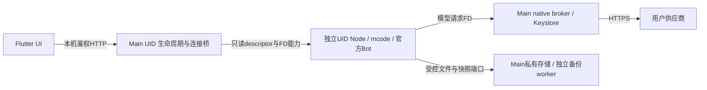

<!-- SPDX-License-Identifier: AGPL-3.0-only -->
# 当前开发状态与验收基线

更新：2026-11-10。**本文件和 [NEXT-AGENT](handoff/NEXT-AGENT.md) 覆盖旧专题卡中的“当前/下一步”。** 下一位先读 AGENTS.md、本文件、NEXT-AGENT、[开发命令](DEVELOPMENT.md)、[隔离约束](sandbox.md)。最新阶段（2026-11-10）：**B2已完成**（产品准入与ARM64调试APK）。手工full-ICU候选已复核并写入[审阅记录](../dsh-go/tooling/android-node-probe/node-arm64-candidate.json)；prepare-arm64-node.py与真实NDK编出ARM64 JNI/SQLite/backup；prepare-product在完整正反例闸门后接通ARM64，Gradle arm64 flavor已编出调试APK（本机产物，未入库）。**仍不是已发布版本，也未经ARM64设备验证，不能称手机可用。** 下一步是[阶段C](handoff/NEXT-AGENT.md)：仅在用户指定的ARM64真机上验收。[接手启动提示词与最后增量](handoff/NEXT-AGENT.md)可直接转发；[ARM64手册](handoff/ARM64-RUNBOOK.md)含编译、消费者与产品准入的实测记录。

## 当前结论

**已有 API35/x86_64 模拟器上的基本可聊天产品调试 APK。真实 MiniMax 连接探针、短文本回复、生成中取消及取消后继续对话已通过。** 不是只有宿主协议夹具，也不是旧 DSH 界面。另有未发布的 ARM64 调试 APK（本机构建，未入库），**未经 ARM64 设备验证，不是完整功能版或已发布版本，不能称手机可用**。

当前运行链（模型Key不进入guest）：

| 项目 | 确切基线 |
|---|---|
| 仓库 / 工作分支 | 私有 Wzdhehe/minimax-bot-android；只在 feat/t-plugins 快进提交推送 |
| 已验产品源码 | `e9d0bebd5fc2487b87d3b5a77b32c2107a0fe54e`，构建时 tracked 工作树干净 |
| 保护分支 | main=`e32fbd7383cd9bdc268aa7df2ec9150e8bc4e48e`；dev/integration=`891aefa71c5aea952ec8aa2502c2ada854854042`，未动 |
| 产品工程 | dsh-go/app；applicationId=`io.github.ccch1mneyyy.dsh_app.mbot` |
| 设备 | emulator-5554，API35/x86_64；Main `u0_a152`、guest `u0_i9036`，同一轮 runtime 内完成三个回合 |
| APK | app-x64-debug.apk，290,642,875 字节；SHA256 `0686e6b46d779c0af056605089f3dce8e5f73dccaf3c0d18f25b1798b078bf53` |
| 上游 | [权威钉点](UPSTREAM-RUNTIME.md)：mcode-webui/minimax-code@97818b2890b4acae1c6bd1200a226ff506680628；官方 Bot 为内置业务源码 |
| 运行时 | Android/Bionic Node24.22.2 full-ICU、better-sqlite3 12.11.1、FD VFS / 私有备份 worker；无 DSH/PRoot rootfs |
| 分发 | APK、签名私料、本机报告未入库，未发布APK/Release、未建PR |

**证据来源是用户转述的本机 Windows agent 报告；云端没有直接读取该 APK、截图或设备日志。** 不将后续未构建的改动套用本基线结论。真实 Key 仅由用户配置在模拟器 App 的加密存储，文档不记录、不复述，不交给下一位 agent。

## 已有证据

| 范围 | 结果和实际边界 |
|---|---|
| 产品启动 | e9d0beb：一次 bot_ready，独立UID，无 FATAL/SIGSEGV，三回合中未重启runtime；install -r保留Bot/凭据，未清数据或force-stop |
| 真实 provider | anthropic-messages；用户在App中配置 MiniMax-M3.1-Flash；一次“测试连接”成功。协议的原生Base URL为 `https://api.minimax.cn/anthropic/v1`，native拼 `/messages` |
| 真实文本 | Chief回复 `TEST PASS`，done / modelCalls=1 / durationMs=6979；取消后又回复 `SECOND OK`，done / modelCalls=1 / durationMs=5947 |
| 取消 | 要求长回复，发出约5秒后点停止；aborted、busyChats清空，再发短消息成功。**没有证明已输出若干token后取消** |
| 流式 | 云端有FD/SSE/SDK和UI状态测试；本轮设备只确认最终气泡/落库，**无逐字增量逐帧证据**。首回合UI约14秒出现气泡，不据此宣称流式性能已达标 |
| 无默认模型 | 11437bb产品：guest `/api/models` 200，default缺失；仍可选模型/effort；手动设回默认后仍200。已结项，不再重派目录500验收 |
| 供应商与恢复 | 016f409产品：存在供应商、完整参数、停用/启用均ready，单次重连或设置返回后横幅自动清除；原生Key不回显 |
| 创建与美术 | d21681e等本机产品报告：真实创建第二个主Bot并回读角色/指令/skin/autoHelper/isMain；多主Bot星标；原版11种材质头像。不是所有业务都已验 |
| 附件 | 同阶段真实系统选择器、上传、预览/移除/取消选择已验；**尚未证明附件进入真实模型并被理解** |
| SQLite与快照 | 31d5864 broker组件1/23项通过；5962d4b Node组合2/58项通过，含活WAL备份、只读/冻结、错身份拒绝、删除后已授予只读FD继续可读。API35/x86_64，不能扩成断电恢复或ARM64设备 |
| 云端最新回归 | e9d0beb：Node124项零skip（实际gateway包装内部15项）、App相关widget19项、analyze零问题、l10n5554键。完整产品host夹具实际probe→Bot/原Anthropic SDK→native FD模拟供应商→文字落库，及native拒绝明确失败且不重提；未使用真实Key |

产品小卡 [T-Flash-RealProviderTurn](handoff/T-Flash-RealProviderTurn.md) **已结项**。本机完整报告留在 D:/mbotapp/docs/research/flash-real-provider-turn.md，未提交；其它 flash-*.md 同理。接手不要假定云端能读 D 盘，也不要为补证据扫描凭据或整机日志。

## e9d0beb 的关键设计，接手不得回退

1. **模型通路**：Key/真实端点只归Main native broker；guest只接收允许列表目录和单次FD能力。FD产品启动已接 provider probe，设置页每次probe取native当前endpoint，不用保存前的旧client。失败不自动重发。
2. **fetch构造时机**：上游可在factory构造期保存fetch，故在构造前安装fail-closed dispatcher；临时空模型租约在真实绑定就位后释放，关闭/失败仍正确回收。不能改成原网络fetch兜底。
3. **native-BYOK审核策略**：原WebUI reviewPolicy=neither会调用移动产品未提供的第一方服务，local_error/input_safety在模型外发前中断，gateway却可返回空finished。精确 runtime.ts→services.js 接缝复用原服务，只在可信native-BYOK构造作用域选择上游已有CLI review策略；owner仍webui，其它policy/wiring原样。真实钉点测试确认自带Key模型不需第一方审核、managed模型仍需。native只准入custom provider；**不支持把此策略扩成托管账号免审核或伪造审核通过**。CLI策略的其它派生业务/插件还需验。
4. **错误与重试**：native SDK/FD拒绝通知当前turn并中断gateway，转明确nonretryable错误；旧完整host夹具曾13次open仍不收敛，修后probe+失败turn共2次open。用户取消与native失败分开。空finished且无文字/待答问题也不能当成功；UI显示安全文案，不显示原始异常。
5. **无默认模型**：可信目录读取的async作用域单独跳过缺省解析，保留鉴权/真实目录DTO/efforts；过滤到native准入模型。不选第一项、不恢复旧全局默认，不吞真实读取错误。
6. **工具权限体验**：可信内置Bot port已有自动allowOnce，不提供“完全允许”等通用agent档位；原问题提问仍需用户回答。native/UID/文件能力边界不能随之放开，真实工具触发尚未验。
7. **运行代次和持久化**：独立UID peer不等于ready；bot_grants_sent也不等于ready。真实匿名403/授权200健康检查通过后才发布endpoint。旧端点不得用于新建/发送。备份的真实死亡、sender结束、Main持有目录能力、UNKNOWN不重提等约束仍有效，见sandbox与源码，不因已经能聊天而删除。

## 现在还缺什么

| 优先级 | 工作 | 明确缺口 |
|---|---|---|
| P0 | ARM64设备验收（阶段C） | **A/B已完成**：手工候选（40c922a producer，内层归档SHA256 `424bee7c…60ec`，libnode `d46110d0…0a93`）复核通过。B1消费者与真实NDK JNI/SQLite addon已落地。B2：prepare-backup双ABI真实编出；prepare-product ARM64闸门与28项正反例（加原x64 7项共35项OK）后解除拒绝；ARM64调试APK 295,445,843字节，SHA256 `6331421c…622f`，仅arm64-v8a，product-inputs 26项全部命中，`.so`均为stored且16KiB对齐，extractNativeLibs=false，无MANAGE_EXTERNAL_STORAGE。x64 APK重编后 lib/ 与 assets/mbot/ 与498a151基线逐项摘要相同。**C缺**：无ARM64设备，KVM不可用，不能拿x64软解模拟器补勾。详见[ARM64手册](handoff/ARM64-RUNBOOK.md) |
| P0并行小项 | 逐字流式/停止观察 | 可用本机已安装的e9d0beb，不必先重编；记录真实增量及首token后停止。不要把完整suite重跑当进展 |
| P1 | effort与多模态 | 五档effort、1M上下文、模态只是可配置；真实provider是否收到/接受尚未验证。附件上传不等于附件入模 |
| P1 | Bot工具/协作/定时 | 每Bot设置与同源任务界面已有；真实模型工具回合、Bot可信MCP caller、自建任务/到点执行、群聊/helper联动未端到端验收 |
| P1 | 插件 | UI/协议客户端已有；生产BotPluginsPort默认api=null、canMutate=false。没有可信插件服务端点、Android兼容/安装执行准入；不许只开开关。MiniApp仍不适配 |
| P2 | 持久与后台 | 更新/重启恢复、进程死亡/未知提交、备份取消/死亡竞态及持久发布存活需产品级验证；不承诺进程被杀后定时仍执行 |
| P2 | UI/分发收尾 | 中屏/平板/折叠屏、手机锁竖屏实机、profile帧率/长历史、通知、工作区项目绑定、设置占位项、许可证/品牌/源码提供义务 |

**下一位的逐项任务、修改范围和停止条件见 [NEXT-AGENT](handoff/NEXT-AGENT.md)。** 不用百分比掩盖上述缺口。旧阶段历史可在[整理前的HANDOFF](https://github.com/Wzdhehe/minimax-bot-android/blob/e9d0bebd5fc2487b87d3b5a77b32c2107a0fe54e/docs/HANDOFF.md)查询；具体旧提交/API26/35组件证据仍在专题卡，不能当新产品全量验收。
