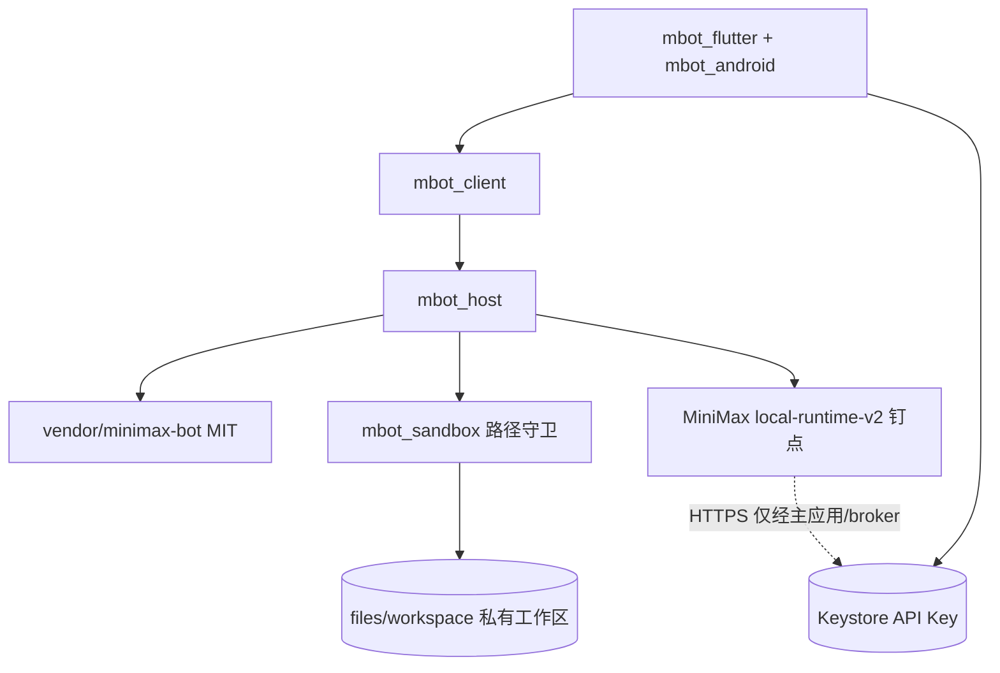

# M Bot Android 架构基线

- **基线 commit**：`326a921`（`main`）
- **文档日期**：2026-11-02（Asia/Shanghai）
- **范围**：目标分层、AGPL 剥离、沙箱接口、设置页 IA、重排里程碑；**不改代码**
- **对照**：`/workspace/minimax-bot-android-review.md`；沙箱用例待对齐 `/workspace/mbot-sandbox-escape-cases.md`（撰写时尚未落盘）

---

## 1. 已决事项与后果

| 决定 | 后果 |
|---|---|
| 考前（11/29 国考、12/26 中烟）**小步继续开发**，不冻结 | 每步可独立验收、可回退；不并行大改 |
| **DSH Go（AGPL-3.0）只参考、不链接** | 最终 APK **不得**包含/链接 `dsh-go/` 下 AGPL 源码；新代码放仓库根 **`packages/`**（不派生自 `dsh-go/`） |
| Runtime 来源 | **待用户再确认**（见 §8）。曾倾向官方 `MiniMax-AI/minimax-code`；同事核实后 webui fork 带完整插件市场，官方 `deliveryTargets` 仅 `desktop`/`cloud`。候选：① 钉 webui fork；② 钉官方并以 webui 为协议参照 |

**硬约束（不变）**：Agent 仅应用私有工作区；PRoot≠安全边界；禁止同 UID 任意 shell；API Key 不进 Agent/插件；本机服务鉴权；定时保活由用户系统设置，App 只检测/提示/跳转；UI 不得声称进程被杀后仍执行。

---

## 2. AGPL 依赖面盘点（`326a921` 实测）

| 路径 | 约规模 | 许可证 | 处置 |
|---|---|---|---|
| `dsh-go/` 整树 | ~4637 文件，~370MB | 根 `LICENSE` = **AGPL-3.0**；品牌见 `ASSETS.md`（**不在 AGPL 内**） | **参考资料库**；不得打进成品 APK |
| `dsh-go/app/` Flutter+Android | Dart `lib/` ~768 文件 / ~29.6 万行；Kotlin `src/main` ~175 文件 | AGPL + 受限品牌/吉祥物 + Phase 等第三方 | **替换**：自研壳；可对照设置 IA / 后台引导 / 通知渠道**思路**，不复制源码 |
| `dsh-go/packages/dsh_client` | ~106 个 `.dart` | 无独立 LICENSE，属 DSH 树 → 按 **AGPL** | **不链接**；协议客户端在根 `packages/` 重写 |
| `dsh-go/packages/dsh_remote` | 自带 MIT 头 | MIT（远程） | 本产品不做远控 → **不纳入** |
| `dsh-go/runtime/`（除 vendor） | 补丁、bridge、media 等 | 随 DSH AGPL；`dsh-media` 自有 LICENSE | **不链接** |
| `dsh-go/runtime/vendor/minimax-bot/` | ~93 文件；钉 `0f2183f` / v0.7.18 | **MIT**（MiniMax） | **可保留**；迁到根 `packages/` 或 `vendor/` |
| `dsh-go/runtime/minimax-bot-host/` | ~303 行（自研适配） | 本仓新增，依赖 vendor Bot | **可保留**；迁出 `dsh-go/` |
| `dsh-go/sdk/plugin-kit` | 自带 MIT | MIT（DSH-TUI） | 仅当确认无 AGPL 混链时再用；默认不依赖 |
| `dsh-go/market/`、`docs/`、`examples/` | 文档/示例 | 随上游 | 参考；成品勿当说明书 |
| 根 `app/` Java 原型 | 4 个 `.java` / ~455 行 | 本仓原型 | **待决**归档或删除（F.9） |

**fork 已写、宜迁出的薄层（勿留在 `dsh-go/`）**：`minimax-bot-host/*`、`mcode_plugins_api.dart` / `minimax_bot_api.dart`、`lib/bot/*`（约数百行）→ 逻辑迁入根 `packages/` 后重写/搬迁，切断对 AGPL 包的 import。

---

## 3. Runtime / 上游核实（精简）

| 仓 | LICENSE | 备注 |
|---|---|---|
| `MiniMax-AI/minimax-code` | MIT | 官方 CLI；含 `packages/local-runtime-v2` |
| `mcode-webui/minimax-code` | **MIT**（已 `gh` 核） | 官方 fork；同事核实：相对官方 **超前 ~1413 / 落后 ~5**；`local-runtime-v2` 至少 ~150 文件有改动；**完整插件市场**（`packages/webui` 市集 UI + 服务端 plugin-management + runtime plugin-system + `docs/plugins/`） |
| 插件包格式 | — | 官方文档：`deliveryTargets` **仅** `desktop` \| `cloud`（无 `android`） |

**本仓现状**：`run-upstream-gateway-smoke.sh` / DEVELOPMENT 仍指向 **webui** 路径与钉 `97818b2`；Bot vendor 来自 MiniApps `0f2183f`。尚未把 runtime 打进 APK。

**升级策略（钉仓后执行）**：选定远程 → 钉 commit + 日期写入 `docs/UPSTREAM-RUNTIME.md` → CI 用该 commit 跑 host smoke → 升钉须变更该文档并重跑 smoke；Android 原生依赖（如 `better-sqlite3`）单独验收。

---

## 4. 目标分层与 `packages/` 划分

新代码**只**落在仓库根 `packages/`（及将来的应用入口模块），**不**在 `dsh-go/` 内继续堆产品代码。`dsh-go/` 只读参考，直至剥离里程碑删除/移出构建图。

```text
packages/
  mbot_android/          # 应用入口：AndroidManifest、FGS、通知渠道、跳转系统设置（Kotlin，自研）
  mbot_flutter/          # Flutter UI 壳：Bot 列表/会话、设置页（自研；布局意象参考 Grok 产品文档，不抄商标）
  mbot_client/           # Dart：Bot HTTP 客户端、插件管理 API、loopback 鉴权头（重写，不 import dsh_client）
  mbot_host/             # Node：内置 Bot 监听、Bearer、拒 Origin/错 Host（自 minimax-bot-host 迁入）
  mbot_sandbox/          # 路径守卫（Dart 测 + 宿主侧实现）；见 §5
  mbot_runtime_pin/      # 上游 runtime 钉点说明、smoke 脚本、vendor 校验（无 AGPL）
vendor/
  minimax-bot/           # MIT 快照（自 dsh-go/runtime/vendor 迁入）
```



**进程与鉴权**

- UI / 主应用持 Key；Agent/插件不得读明文 Key。
- Bot HTTP：`127.0.0.1` + 随机 Bearer；拒绝 `Origin`；`Host` 必须匹配；重启换凭据（现 `service.mjs` 行为迁入 `mbot_host`）。
- 工具 FS：**仅**经宿主侧 `mbot_sandbox`；Agent 内自检不算边界。
- 目标再评估 `isolatedProcess` / broker；失败则保持「无任意 shell、仅结构化工具」。

---

## 5. 沙箱接口约定（开发验收依据）

> 用例清单将与审查文档 `mbot-sandbox-escape-cases.md` 对齐；该文件撰写时未落盘，下列为基线约定，落盘后以审查用例 ID 回链补丁本节约。

### 5.1 工作区根

- 根目录 = `context.getFilesDir()/workspace`（或等价应用私有目录下**专用子树**）。
- **不**把整个 `files/`、密钥目录、WebView 缓存、缓存目录交给 Agent。
- 对外 API 只接受**工作区相对路径**（Unicode 正规化后）；禁止以绝对路径、`content://`、`file://` 直接当工作区路径（SAF 结果须经 broker **拷贝/FD 导入**后再相对化）。

### 5.2 守卫函数（建议签名）

```text
resolveWorkspacePath(workspaceRoot: Path, userPath: String): Result<Path, SandboxError>
```

**语义（必须全部满足）**

1. 拒绝空、含 `\0`、原始绝对路径（POSIX `/` 或 Windows 盘符）。
2. 按 `/` 分段；遇 `.` 忽略；遇 `..` 上溯，若越出 root → `ESCAPE`。
3. **逐段** `realpath`/canonical（每段解析 symlink）；任一 symlink 目标落在 root 外 → `ESCAPE`。
4. 最终 canonical 路径必须仍以 canonical(root) 为前缀（边界用分隔符，防 `/workspace` vs `/workspace-evil`）。
5. 显式拒绝前缀/目标落到 `/sdcard`、`/storage/emulated`、`/data/data/<其它包>`、`/data/user/*/…` 非本包等（即便因错误配置 root 指错也要失败）。
6. **TOCTOU**：resolve 与 open/读写之间目录可被替换；持有 FD 后基于 FD 操作，或在写前再次 `resolve`+同一生成号；测试须含「resolve 后替换 symlink」竞态。
7. 只读/只写策略由调用方传入；默认写操作需用户审批（产品层），但**路径合法性不因审批而放宽**。

**错误码（稳定字符串，供测试断言）**

| 码 | 含义 |
|---|---|
| `EMPTY` | 空/非法输入 |
| `ABSOLUTE` | 绝对路径 |
| `ESCAPE` | `..` / symlink / 前缀逃逸 |
| `DENIED_SYSTEM` | `/sdcard` 或其他 App 目录等 |
| `NOT_FOUND` | 相对合法但不存在（若 API 区分） |
| `IO` | 其它 I/O |

### 5.3 强制层次

- **唯一强制点**：`mbot_host` / Android broker 在执行 FS 工具前调用 `resolveWorkspacePath`。
- Agent、插件、提示词、UI 校验均**不可**替代该层。
- 禁止为「方便」提供同 UID 任意 shell。

### 5.4 必须覆盖的测试用例

| ID | 用例 | 期望 |
|---|---|---|
| S1 | `notes/a.txt` | 成功，落在 root 下 |
| S2 | `../workspace-sibling` / `../../files/secret` | `ESCAPE` |
| S3 | 绝对路径 `/sdcard/DCIM/x`、`/data/data/com.other/x` | `ABSOLUTE` 或 `DENIED_SYSTEM` |
| S4 | symlink 指向 root 外 | `ESCAPE` |
| S5 | 中间目录 symlink 逃逸（`a -> /sdcard` 再 `a/b`） | `ESCAPE` |
| S6 | symlink 指向 root 内合法文件 | 成功 |
| S7 | `foo/../../workspace/notes` 绕圈后仍在 root | 成功或按正规化策略文档化 |
| S8 | 路径前缀攻击 `workspace_evil`（root=`.../workspace`） | `ESCAPE` |
| S9 | `\0`、多余 `/`、`.` 段 | 拒绝或正规化后安全 |
| S10 | resolve 后替换为外指 symlink 再写（TOCTOU） | 失败或写不到 root 外 |
| S11 | 包名相邻目录 / 其它用户 `files` | 拒绝 |
| S12 | 空字符串、仅 `..`、仅 `/` | 错误码非成功 |

真机/仪器补测：「读 `/sdcard` 应失败」手工证据链到审查报告。

---

## 6. 设置页信息架构

### 6.1 首页分组（草案）

账号与模型 · **插件** · **通知** · 定时任务 · **后台运行** · 工作区与存储 · 外观 · 关于  

（无远控/手机操控项。）

### 6.2 通知页（条目级）

| 条目 | 行为 | 验收 |
|---|---|---|
| 总开关 | 映射系统「应用通知」是否允许；关则各分类不发 | 读 `NotificationManager.areNotificationsEnabled()`；按钮跳转 `Settings.ACTION_APP_NOTIFICATION_SETTINGS`（或渠道设置） |
| 分类：定时任务 | App 偏好 + 渠道 `schedule_due` | 关后到点**不**弹该渠道；开且系统允许则档位 A 可测到达 |
| 分类：Bot 消息/一轮完成 | 渠道如 `bot_done` | 同上 |
| 分类：出错或打断 | 渠道如 `bot_error` | 同上 |
| 分类：等待确认 / 向你提问 | 渠道如 `bot_attention` | 可裁剪，但不得静默丢审批 |
| 打开系统渠道设置 | 深链到对应 `NotificationChannel` | 改系统重要性后，页内状态刷新为一致 |

**文案**：说明「关闭通知或系统拒发时，你可能错过定时与待确认」；**不**写「仍会在后台保证送达」。

### 6.3 后台运行页（条目级）

| 条目 | 检测 | 跳转 | 验收 |
|---|---|---|---|
| 引擎/前台服务是否在跑 | 自研 FGS/服务状态 | 提供「启动引擎」若产品需要 | 状态与真实进程一致；滑掉任务后显示未运行 |
| 通知权限 | `areNotificationsEnabled()` | `ACTION_APP_NOTIFICATION_SETTINGS` | 与通知页一致 |
| 电池优化白名单 | `PowerManager.isIgnoringBatteryOptimizations(pkg)` | `Settings.ACTION_REQUEST_IGNORE_BATTERY_OPTIMIZATIONS`（或应用详情） | 只请求/跳转一次路径清晰；不自动循环弹窗 |
| 厂商后台/自启动说明 | `Build.MANUFACTURER/BRAND` 选文案（小米/vivo/华为/OPPO/三星等）；**无法可靠读开关则只显示步骤** | 能解析则试打开厂商页，失败则应用详情 `ACTION_APPLICATION_DETAILS_SETTINGS` | 文案标明「因 ROM 而异，可能失效」 |
| 最近任务锁定 | 无法 API 可靠检测 → **仅说明文案** | 无或应用详情 | 不假装已检测为「已锁定」 |
| 风险说明（固定） | — | — | **必须**出现：「进程被杀或系统限后台后，定时任务**不会**执行；App 不能保证补跑。」禁止相反承诺 |

**原则**：只检测、提示、跳转；不做保活黑科技。厂商 Intent 属 fragile，失败应降级，不得崩溃。

---

## 7. AGPL 剥离与重排里程碑（替换报告 E）

每步可独立合并验收；考前保持小步。

| 步 | 内容 | 验收 | 粗估 |
|---|---|---|---|
| **M0** | 本文合入；E0 文档卫生由开发分支负责（本分支不改 README/parity/DEVELOPMENT） | 新人读架构知「APK 不得链 AGPL」 | 0.5d |
| **M1** | 根 `packages/` 骨架 + 迁 `vendor/minimax-bot` + `mbot_host`（测从 `dsh-go` 拷出） | `node --test` host 用例绿；**构建图不编译进 dsh-go App** | 1–2d |
| **M2** | `mbot_sandbox` + §5 用例自动化 | S1–S12 CI 绿 | 1–2d |
| **M3** | `mbot_flutter` 最小 Bot 列表/会话 + 设置壳（假数据） | 冷启动进 Bot UI；通知/后台两页条目齐全；文案含「被杀不执行」 | 3–5d |
| **M4** | `mbot_android` FGS/通知渠道/跳转 | 渠道存在；电池优化检测与跳转真机或模拟器记录 | 2–3d |
| **M5** | 钉 runtime（待 §8 确认）+ host smoke | 文档钉 commit；smoke 绿；不声称 APK 已嵌入 | 2–4d |
| **M6** | 设置：账号 Keystore、插件 UI（明示无 android `deliveryTargets`） | Key 不进 Agent 环境；限制有 UI 提示 | 3–5d |
| **M7** | Runtime 进 APK（高风险，考后可放大） | 设备一次模型往返；失败不回退同 UID shell | 10–20d |
| **M8** | 定时档位 A + 引导档 C；档 B 文档化 | 存活则到点通知；UI 不说谎 | 3–5d |
| **M9** | 构建彻底去掉 `dsh-go/`；许可页仅 MIT/自研/第三方 | APK 扫描无 AGPL 源码路径；feature-parity 有证据 | 2–4d |

考前优先：**M1→M4**（骨架、沙箱、设置真页、通知/后台诚实 UI）；M5 起视精力与 §8 决定。

---

## 8. 仍待决问题

1. **Runtime 钉谁**：官方 vs webui fork（插件市场完整性 vs 「正统」上游）。**需用户再拍板**。  
2. **插件 Android 分发 / 登录**：无 `android` target 时只允许固定 commit 导入？是否要 MiniMax 登录？  
3. **Grok 布局**：参考图与「不要的元素」清单。  
4. **FGS 类型**：继续 `specialUse`？是否上架？  
5. **`REQUEST_INSTALL_PACKAGES`**：纯 Bot 是否删除。  
6. **定时死后补跑**：仅进程存活（默认对齐官方 Bot）vs Alarm 拉起（另设验收）。  
7. **根 `app/` 原型**：删除或归档，避免双轨 CI。

**建议下一步先拍板**：① Runtime 钉 webui 还是官方；② 定时是否坚持「仅进程存活」以免考前引入 Alarm 权限复杂度。

---

## 9. 与分析报告的差异

- 用户已决「DSH 不链接」→ 报告 E「在 dsh-go Flutter 上切默认入口」**作废**，改为根 `packages/` 自研壳。  
- 「Runtime 跟官方」与「插件市场在 webui 更完整」存在张力 → 本文 §3/§8 升为**再确认**，不静默改用户原意。  
- 开发约定新代码在根 `packages/` → 与报告「继续改 dsh-go/app」不同，以本文为准。  
- `mbot-sandbox-escape-cases.md` 未落盘 → §5.4 为基线清单，审查文件出现后回链对齐。

