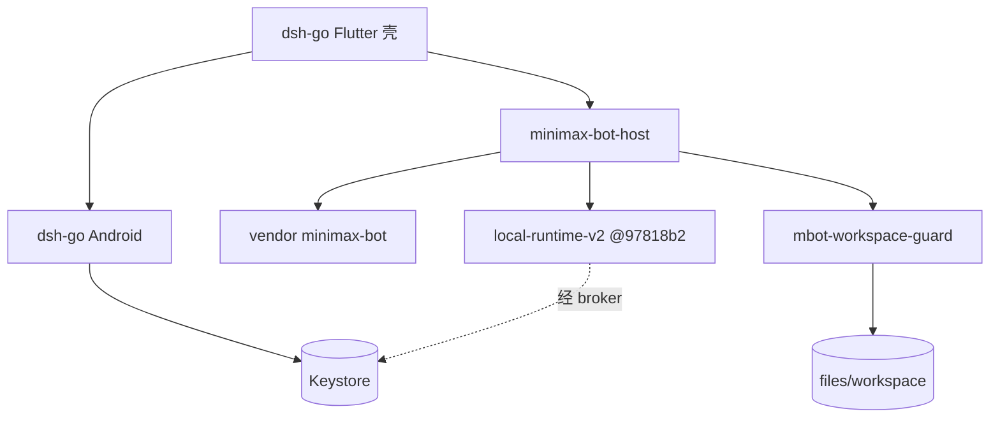

# M Bot Android 架构基线（MiniMax Code 工作计划）

- **基线**：`origin/main` 含 `e32fbd7`（Keystore Key）；本文档分支自 `326a921` 起叠文档
- **日期**：2026-11-02（Asia/Shanghai）
- **用法**：外部用 MiniMax Code 按下方**考前任务卡**开发；本团队只做验收。对照 `/workspace/minimax-bot-android-review.md`

---

## 1. 已决事项

| 决定 | 后果 |
|---|---|
| 考前小步开发 | 每卡一 PR；考前关入口，考后再删模块 |
| AGPL-3.0 开源 + **留壳换芯** | 留 DSH Flutter/Android/通知/设置/平板/插件市场交互；换 DSH 引擎、plugin-kit、手机内 Ubuntu+pnpm → MiniMax runtime + 插件协议。新文件加 AGPL 头；发布须能提供源码；品牌素材受 `dsh-go/ASSETS.md` 限制 |
| Runtime | **跟** `mcode-webui/minimax-code`（MIT，`97818b2`）；复用其插件管理。官方 `MiniMax-AI/minimax-code` 更新自行合并 |

**硬约束**：Agent 仅应用私有工作区；PRoot≠安全边界；禁止同 UID 任意 shell；路径不可逃逸；API Key 不进 Agent/插件；本机服务鉴权；定时保活由用户系统设置，App 只检测/提示/跳转；UI 不得声称进程被杀后仍执行。**不采用**手机内 Ubuntu+pnpm 安装链。

**Key 存储（`e32fbd7`，审查已过）**：`BotSettingsPlugin.kt` + `bot_settings.dart`；`minimax_bot_provider` SharedPreferences（`MODE_PRIVATE`）存 AES-GCM 密文+IV；AndroidKeyStore；无日志；`readKeyForBroker` 未挂 MethodChannel；`allowBackup="false"`（升 targetSdk≥31 时须另配 dataExtractionRules，见 T-Sandbox）。

---

## 2. 基线资产（处置）

| 路径 | 处置 |
|---|---|
| `dsh-go/app/` Flutter+Android（AGPL） | 壳：继续改 |
| `dsh-go/packages/dsh_client` | 可复用；含 `lib/src/mcode_plugins_api.dart` |
| `dsh-go/sdk/plugin-kit`、DSH 引擎 schedule | 芯：逐步停用 |
| `dsh-go/runtime/vendor/minimax-bot/`（MIT `0f2183f`） | 保留 |
| `dsh-go/runtime/minimax-bot-host/` | 保留并扩展 |
| 根 `packages/mbot_settings/`（分支 `feat/settings-skeleton`） | 设置骨架，待接入壳 |
| 根 `packages/mbot-workspace-guard/`（分支 `feat/mbot-workspace-guard`） | 路径守卫，待接入宿主 |
| 根 `app/` Java 原型 | 待决归档/删除 |



---

## 3. 考前任务卡（每卡一 PR）

共用禁止项：禁止同 UID 任意 shell；不加 `MANAGE_EXTERNAL_STORAGE`；API Key 不暴露给 Agent/插件；不推 `main`、不 force push、不改历史；推远程/开 PR 须用户同意。

### T-Settings — 设置骨架接入壳

- **目标**：把 `packages/mbot_settings/`（通知页、后台运行页、6 组占位）接入 DSH 设置入口；分组与 `lib/src/ia/settings_groups.dart` 一致：账号与模型 · 插件 · 通知 · 定时任务 · 后台运行 · 工作区 · 外观 · 关于。总开关关则子项灰显；后台页只跳系统设置，文案写明进程被杀后定时不跑。
- **触碰**：`packages/mbot_settings/`；`dsh-go/app/lib/` 设置路由/入口；必要时 `dsh-go/app/pubspec.yaml`。
- **依赖**：无（可先于沙箱）。
- **验收**：
  ```bash
  cd packages/mbot_settings && flutter test && dart analyze
  cd dsh-go/app && flutter test test/bots/minimax_bot_home_test.dart
  ```
  通过：既有 mbot_settings 测试全绿；冷启动能进设置；通知/后台文案符合上表；无远控/操控入口。

### T-Sandbox — 工作区守卫 + 存储收紧

- **目标**：`packages/mbot-workspace-guard/` 接入宿主 FS 强制点；删 FileProvider 宽外部路径；升 `targetSdk`；备份排除 Key prefs。
- **触碰**：
  - `packages/mbot-workspace-guard/`（`src/index.js`；`npm test` = `node --test`）
  - `dsh-go/runtime/minimax-bot-host/`（强制调用点）
  - `dsh-go/app/android/app/src/main/res/xml/dsh_file_paths.xml`：**删除** `<external-path name="storage" path="." />`
  - `dsh-go/app/android/app/build.gradle.kts`：`targetSdk` 现为 **28** → 升到**当前 Play 要求版本**（根 `app/build.gradle` 现为 35，可作参考；升后去掉/调整 `ExpiredTargetSdkVersion` lint 豁免）
  - `dsh-go/app/android/app/src/main/AndroidManifest.xml`：`targetSdk≥31` 时配置 `dataExtractionRules`（及 `fullBackupContent`），排除 `minimax_bot_provider` SharedPreferences 的云备份与设备迁移
- **接口**：`resolveWorkspacePath(root, userPath)`；拒空/`\0`/绝对/`..`/symlink 逃逸/前缀混淆/`/sdcard`/他 App 目录。根：`context.getFilesDir()/workspace`。
- **依赖**：守卫模块已在 `feat/mbot-workspace-guard`（`da717eb`，8/8）；本卡负责接入与 Android 侧收紧。
- **验收**：
  ```bash
  cd packages/mbot-workspace-guard && npm test
  cd dsh-go && node --test runtime/minimax-bot-host/agent-port.test.mjs runtime/minimax-bot-host/service.test.mjs
  ```
  通过：守卫测试全绿；宿主强制调用可测；`dsh_file_paths.xml` 无 `external-path` storage；`targetSdk` 已升；读 `/sdcard` 失败（真机或仪器测试）；`dataExtractionRules`/`fullBackupContent` 排除 `minimax_bot_provider`；无同 UID shell。

### T-Schedule — 定时任务 + 通知（进程存活档）

- **目标**：进程/约定服务存活时到点执行并发通知；设置可开关通知渠道；后台页只检测+跳转。UI/文档不得承诺进程被杀后仍执行（死后补跑档位未定）。
- **触碰**：`dsh-go/app/` 通知渠道与设置；Bot 调度相关（vendor/host，不引入 Ubuntu+pnpm）；`packages/mbot_settings/` 通知/后台/定时分组。
- **依赖**：T-Settings（入口与文案）。
- **验收**：
  ```bash
  cd packages/mbot_settings && flutter test
  cd dsh-go/app && flutter test test/bots/minimax_bot_home_test.dart
  ```
  通过：存活场景到点有通知；关总开关不发；文案含「进程被杀后不会执行」；无保活黑科技。

### T-Plugins — 插件市场（webui 插件管理）

- **目标**：设置页插件组对接 webui fork 的 plugin-management / plugin-system；UI 走已有 `mcode_plugins_api.dart`（市场、安装、卸载、启停）。明示官方包格式无 `android` target；安装策略未定前不得假装可装任意桌面插件。禁止设备内 Ubuntu+pnpm。
- **触碰**：`dsh-go/packages/dsh_client/lib/src/mcode_plugins_api.dart`；设置插件 UI；host/runtime 侧接入 fork 的 plugin-management（钉点见 T-Runtime）。
- **依赖**：T-Runtime（协议后端）；T-Settings（入口）。
- **验收**：
  ```bash
  cd dsh-go/packages/dsh_client
  dart analyze lib/src/mcode_plugins_api.dart test/mcode_plugins_api_test.dart test/mcode_plugins_runtime_test.dart
  dart test test/mcode_plugins_api_test.dart
  # 有已构建的 webui 时：
  MCODE_WEBUI_ENTRY=/path/to/minimax-code/dist-webui-npm/bin/mcode-webui.mjs dart test test/mcode_plugins_runtime_test.dart
  ```
  通过：协议测试绿；UI 能列出/启停（以宿主机或 mock 为准）；无 android target 有提示；无同 UID shell、无 Key 泄露。

### T-Runtime — 钉 webui fork `97818b2`

- **目标**：文档与 CI/smoke 钉 `mcode-webui/minimax-code@97818b2`；host 能对 fork 做 smoke；写 `docs/UPSTREAM-RUNTIME.md`（commit+日期）。升钉须重跑。
- **触碰**：`dsh-go/runtime/minimax-bot-host/`；上游钉点文档；必要时 vendor/锁文件。
- **依赖**：无（可与 T-Plugins 并行准备）。
- **验收**：
  ```bash
  cd dsh-go
  node --test runtime/minimax-bot-host/agent-port.test.mjs runtime/minimax-bot-host/service.test.mjs
  WEBUI_SOURCE=/path/to/minimax-code@97818b2 bash runtime/minimax-bot-host/run-upstream-gateway-smoke.sh
  ```
  通过：host 测试绿；smoke 绿（或文档记录阻塞原因）；钉点文件与 `97818b2` 一致。

---

## 4. 考后 / 未发卡（勿提前扩 scope）

| 原里程碑 | 内容 |
|---|---|
| 关入口 | 宠物/论坛/操控/Ubuntu 等考前隐藏 |
| Runtime 进 APK | 设备一次模型往返（高风险） |
| 考后删模块 + 换品牌 + 源码发布流程 | ASSETS / AGPL 合规 |
| 仍待决 | 插件 Android 安装/登录；Grok 参考图；FGS 类型；`REQUEST_INSTALL_PACKAGES`；定时死后补跑档；根 `app/` 去留 |

---

## 5. 验收流程

1. **外部开发（MiniMax Code）**：按任务卡开独立分支，本地提交；附上该卡「验收」命令的完整输出；不推 `main`。
2. **审查**：复跑验收命令；核对硬约束（沙箱、无同 UID shell、无宽存储权限、Key 不进 Agent/插件、定时文案诚实）。
3. **架构**：对照本文与代码路径/接口是否一致；不一致则改文档或退回开发。

---

## 6. 设置 / 沙箱摘要（细节以任务卡为准）

设置分组与验收口径见 **T-Settings** / `packages/mbot_settings/lib/src/ia/settings_groups.dart`。沙箱用例与 Android 收紧见 **T-Sandbox**；设计背景见 [sandbox.md](sandbox.md)。
