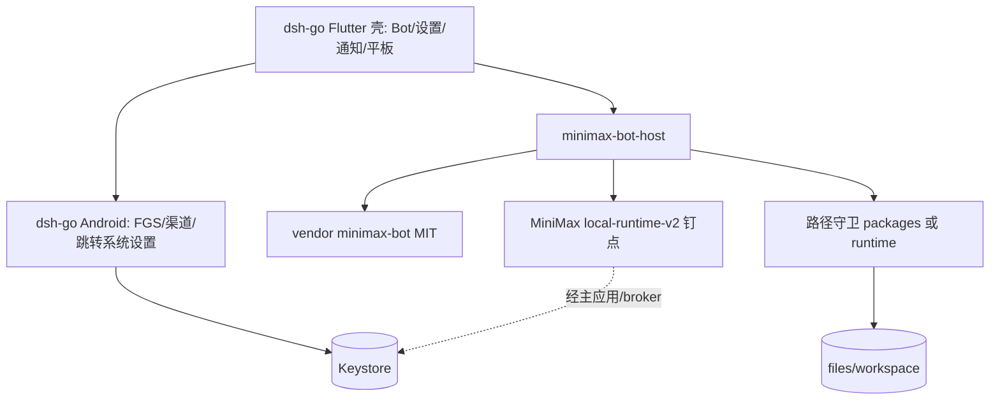

# M Bot Android 架构基线

- **基线 commit**：`326a921`（`main`）
- **文档日期**：2026-11-02（Asia/Shanghai）；**策略修订**：同日改「AGPL 开源 + 留壳换芯」
- **对照**：`/workspace/minimax-bot-android-review.md`；沙箱用例待对齐 `mbot-sandbox-escape-cases.md`

---

## 1. 已决事项与后果

| 决定 | 后果 |
|---|---|
| 考前**小步继续开发** | 每步可独立验收；考前关入口、考后再删模块 |
| **App 按 AGPL-3.0 开源**，可直接 fork/复用 DSH Go | 保留 DSH 版权与 `LICENSE`；**新文件加 AGPL 头**；发布 APK 须能提供对应源码；品牌/吉祥物仍受 `dsh-go/ASSETS.md` 限制，发布前替换 |
| **留壳换芯** | **留**：DSH Flutter UI、Android 原生、通知、设置页、平板布局、插件市场**交互流程**。**换**：DSH 引擎、`plugin-kit` 插件格式、本机 Ubuntu+pnpm 安装方式 → MiniMax runtime + MiniMax 插件协议 |
| Runtime 钉点 | **仍待用户确认**；**建议钉 webui fork**（`mcode-webui/minimax-code`，MIT，插件市场完整）。候选另有官方 `MiniMax-AI/minimax-code`（`deliveryTargets` 仅 desktop/cloud） |

**硬约束**：Agent 仅应用私有工作区；PRoot≠安全边界；**禁止同 UID 任意 shell**；路径不可逃逸；API Key 不进 Agent/插件；本机服务鉴权；定时保活由用户系统设置，App 只检测/提示/跳转；UI 不得声称进程被杀后仍执行。

**明确不采用**：DSH 在手机内跑 Ubuntu + pnpm 的插件/依赖安装路径。

---

## 2. 基线资产（处置）

| 路径 | 约规模 / 许可 | 处置 |
|---|---|---|
| `dsh-go/app/` Flutter+Android | ~768 Dart / ~175 Kotlin main；AGPL | **壳**：继续改；关无用入口 |
| `dsh-go/packages/dsh_client` 等 | AGPL | 可复用；远控相关不纳入产品 |
| `dsh-go/sdk/plugin-kit`、引擎侧 schedule 等 | 混 MIT/AGPL | **芯**：逐步停用，不作为插件/引擎真相来源 |
| `dsh-go/runtime/vendor/minimax-bot/` | MIT，`0f2183f` | **保留**，内置 Bot |
| `dsh-go/runtime/minimax-bot-host/` | 本仓薄宿主 ~303 行 | **保留并扩展**，对接 MiniMax runtime |
| 根 `packages/mbot_settings/` | 开发中 | **可并入或接入** DSH 设置页（以开发实际模块名为准） |
| 根 `packages/mbot-workspace-guard/` 等 | 开发中 | 沙箱守卫；接入宿主强制点 |
| 根 `app/` Java 原型 | ~455 行 | 待决归档/删除 |

---

## 3. Runtime / 上游

| 仓 | LICENSE | 备注 |
|---|---|---|
| `mcode-webui/minimax-code` | MIT | **建议钉**；相对官方超前多、插件市场完整（webui + plugin-management + plugin-system） |
| `MiniMax-AI/minimax-code` | MIT | 官方；`local-runtime-v2` 同源但有分叉；包格式无 `android` target |
| MiniMax Bot vendor | MIT | 已钉 `0f2183f` |

钉仓后：`docs/UPSTREAM-RUNTIME.md` 写 commit+日期；CI smoke；升钉重跑。本仓 smoke 脚本现仍按 webui 路径编写。

---

## 4. 目标分层（在 DSH 基线上改）



- 默认入口切到 Bot UI；宠物/论坛/手机操控/本机 Ubuntu 等**考前隐藏或禁用入口**，考后删除代码与权限。
- 插件：UI 流程可参考 DSH 设置，**协议与安装**走 MiniMax（非 plugin-kit、非设备内 Ubuntu+pnpm）。
- 鉴权：loopback + Bearer；拒 Origin；Host 匹配；重启换凭据。

---

## 5. 沙箱接口约定（验收依据）

> 与审查 `mbot-sandbox-escape-cases.md` 对齐；未落盘前以下列为基线。

### 5.1 工作区根

`context.getFilesDir()/workspace`（专用子树）。不把整个 `files/`、密钥、WebView 缓存交给 Agent。API 只接受工作区相对路径；SAF 经 broker 拷贝/FD 导入。

### 5.2 守卫

```text
resolveWorkspacePath(workspaceRoot: Path, userPath: String): Result<Path, SandboxError>
```

拒绝空/`\0`/绝对路径；分段处理 `.`/`..`；**逐段**解析 symlink；最终路径必须以 canonical(root) 为前缀（防前缀攻击）；拒绝 `/sdcard`、其他 App 目录等；注意 TOCTOU（resolve 后替换 symlink）；写权限不放宽路径规则。

错误码：`EMPTY` | `ABSOLUTE` | `ESCAPE` | `DENIED_SYSTEM` | `NOT_FOUND` | `IO`。

### 5.3 强制层

宿主 / Android broker 在 FS 工具执行前调用；Agent/UI 自检无效。**禁止同 UID 任意 shell**。不采用 DSH 手机内 Ubuntu+pnpm 安装链。

### 5.4 用例 S1–S12

相对合法路径成功；`..`、绝对路径、外指 symlink、中间目录 symlink 逃逸、前缀攻击、`\0`、TOCTOU、其他包目录、空/`..`/`/` → 非成功。真机补「读 `/sdcard` 失败」。

---

## 6. 设置页 IA

分组：账号与模型 · 插件 · **通知** · 定时任务 · **后台运行** · 工作区 · 外观 · 关于（无远控/操控）。`packages/mbot_settings/` 可并入 DSH 设置信息架构。

### 6.1 通知

| 条目 | 验收 |
|---|---|
| 总开关 | `areNotificationsEnabled()`；跳转 `ACTION_APP_NOTIFICATION_SETTINGS` |
| 分类：定时 / 完成 / 出错 / 待确认 | 各渠道；App 关则不发 |
| 系统渠道设置 | 深链后状态一致 |

文案不承诺「后台保证送达」。

### 6.2 后台运行

| 条目 | 检测 / 跳转 | 验收 |
|---|---|---|
| 引擎是否在跑 | FGS/服务状态 | 与真实一致 |
| 通知权限 | 同上 | 与通知页一致 |
| 电池优化 | `isIgnoringBatteryOptimizations` → `ACTION_REQUEST_IGNORE_BATTERY_OPTIMIZATIONS` 或应用详情 | 不循环弹窗 |
| 厂商后台文案 | MANUFACTURER 选文案；Intent 失败则应用详情 | 标明 ROM 可能失效 |
| 最近任务锁定 | 仅文案 | 不假装已检测 |
| 风险说明 | 固定文案 | **必须**写：进程被杀后定时**不会**执行 |

只检测、提示、跳转；无保活黑科技。

---

## 7. 里程碑（在 DSH 基线上改）

| 步 | 内容 | 验收 | 粗估 |
|---|---|---|---|
| **M0** | 本文；E0 文档由开发分支 | 策略为「留壳换芯 + AGPL 开源」 | 0.5d |
| **M1** | 考前关闭宠物/论坛/操控/Ubuntu 等入口；许可头检查 | 冷启动无上述入口；新文件有 AGPL 头 | 1–2d |
| **M2** | 默认进 Bot UI；`mbot_settings` 接入设置 | 通知/后台条目与 §6 文案达标 | 2–4d |
| **M3** | 路径守卫接入宿主 + S1–S12 | CI 绿；无同 UID shell | 1–2d |
| **M4** | 钉 runtime（待确认，建议 webui）+ host smoke | 文档钉点；smoke 绿 | 2–4d |
| **M5** | 设置：Keystore、插件 UI（明示无 android target） | Key 不进 Agent；限制有提示 | 3–5d |
| **M6** | Runtime 进 APK（高风险） | 设备一次模型往返；失败不回退 shell | 10–20d |
| **M7** | 定时档 A + 引导 C；档 B 诚实文档 | 存活到点通知；UI 不说谎 | 3–5d |
| **M8** | 考后删除已关闭模块；换品牌素材；源码发布流程 | APK 与源码对应；ASSETS 合规 | 3–6d |

考前优先 **M1–M4**。

---

## 8. 仍待决

1. **Runtime 钉 webui 还是官方**（建议 webui）。  
2. 插件无 `android` target 时的分发/登录策略。  
3. Grok 布局参考图与禁忌元素。  
4. FGS 类型 / 是否上架。  
5. 是否保留 `REQUEST_INSTALL_PACKAGES`。  
6. 定时死后是否补跑（默认：仅进程存活）。  
7. 根 `app/` 原型去留。

---

## 9. 与前版/报告差异

- 撤回「DSH 只参考不链接 / APK 去 AGPL」；改为 **AGPL 开源 + 留壳换芯**。  
- 里程碑回到 **在 `dsh-go` 上改**；根 `packages/*` 为可接入模块，不以「替代整个壳」为前提。  
- Runtime 仍待确认，建议 webui。  
- 沙箱硬线与「不用 Ubuntu+pnpm 安装」不变。
