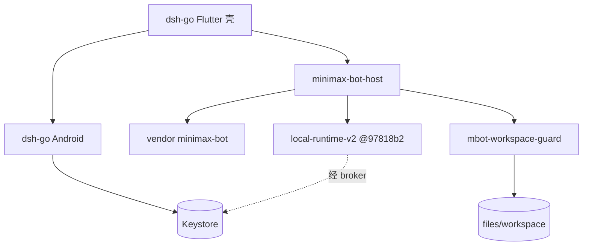

# M Bot Android 架构基线（MiniMax Code 工作计划）

> 当前实施状态（2026-11-07）：e9d0beb官方Bot产品已在API35/x86_64通过真实MiniMax文本、生成中取消及再次对话；ARM64产品仍缺准入。先读[HANDOFF](HANDOFF.md)与[NEXT-AGENT](handoff/NEXT-AGENT.md)。本文保留架构决定与早期任务卡；旧“尚未接入/一张卡一PR/考前暂停”不再是当前安排，不能据此重做已完成核心。当前仅feat/t-plugins阶段提交推送，不PR，不动main/dev/integration。

- **基线**：`origin/main` 含 `e32fbd7`（Keystore Key）；本文档分支自 `326a921` 起叠文档
- **日期**：2026-11-02（Asia/Shanghai）
- **用法**：外部用 MiniMax Code 按下方**考前任务卡**开发；本团队只做验收。对照 `/workspace/minimax-bot-android-review.md`

---

## 1. 已决事项

**2026-11-03 用户补充（优先于旧卡的全局 IA）**：自动任务入口位于每个 Bot 的资料/设置页；用户手工管理与 Bot 经 mbot MCP 创建的定时任务共用同一 runtime 数据源。全局设置不再展示「定时任务」组，不增加电脑/远控入口。Bot 调度使用既有 mbot/mcode 工具与进程内 scheduler，不另建 Android 系统调度链。

**2026-11-03 界面与目录补充**：主要页面沿用 DSH 路由过渡，初次加载使用轻量骨架，尊重系统减少动态效果与 DSH 性能降级；不得用视觉动画造成逐 token 网络刷新。工作目录采用一个应用私有总工作区 `filesDir/workspace`，项目作为子目录，多个 Bot 可绑定同一项目协作。当前仅总根与路径守卫已接入，项目绑定/管理 UI 和运行时 cwd 尚未实现；工作目录与授权范围分开，不能将子目录或 cwd 当成系统级沙箱。DSH Go 允许团队默认目录及 Bot/群聊自选目录，参考其 `docs/guide/zh/12-bots.md`。

| 决定 | 后果 |
|---|---|
| 阶段开发与协作 | 当前仅feat/t-plugins可审阅阶段commit/push；不PR/force，不动main/dev/integration；按NEXT-AGENT拆分核心与本机任务 |
| AGPL-3.0 开源 + **留壳换芯** | 留 DSH Flutter/Android/通知/设置/平板/插件市场交互；换 DSH 引擎、plugin-kit、手机内 Ubuntu+pnpm → MiniMax runtime + 插件协议。新文件加 AGPL 头；发布须能提供源码；品牌素材受 `dsh-go/ASSETS.md` 限制 |
| Runtime | **跟** `mcode-webui/minimax-code`（MIT，`97818b2`）；复用其插件管理。官方 `MiniMax-AI/minimax-code` 更新自行合并 |

**硬约束**：Agent 仅应用私有工作区；PRoot≠安全边界；禁止同 UID 任意 shell；路径不可逃逸；API Key 不进 Agent/插件；本机服务鉴权；定时保活由用户系统设置，App 只检测/提示/跳转；UI 不得声称进程被杀后仍执行。**不采用**手机内 Ubuntu+pnpm 安装链。

**Key 存储（`e32fbd7`，审查已过；多供应商扩展见 T-Providers）**：`BotSettingsPlugin.kt` + `bot_settings.dart`；`minimax_bot_provider` SharedPreferences（`MODE_PRIVATE`）存 AES-GCM 密文+IV；AndroidKeyStore；无日志；`readKeyForBroker` 未挂 MethodChannel；`allowBackup="false"`（升 targetSdk≥31 时须另配 dataExtractionRules，见 T-Sandbox）。

---

## 2. 基线资产（处置）

| 路径 | 处置 |
|---|---|
| `dsh-go/app/` Flutter+Android（AGPL） | 壳：继续改 |
| `dsh-go/packages/dsh_client` | 可复用；含 `lib/src/mcode_plugins_api.dart` |
| `dsh-go/sdk/plugin-kit`、DSH 引擎 schedule | 芯：逐步停用 |
| `dsh-go/runtime/vendor/minimax-bot/`（MIT `0f2183f`） | 保留 |
| `dsh-go/runtime/minimax-bot-host/` | 保留并扩展 |
| 根 `packages/mbot_settings/`（分支 `feat/settings-skeleton`） | 设置骨架，待接入壳 |
| 根 `packages/mbot-workspace-guard/`（分支 `feat/mbot-workspace-guard`） | 路径守卫，待接入宿主 |
| 根 `app/` Java 原型 | 待决归档/删除 |



---

## 3. 考前任务卡（每卡一 PR）

执行顺序：**T-Runtime** → **T-Sandbox** → **T-Settings** → **T-Providers** → **T-Usage** → **T-Schedule** → **T-Plugins**（每卡一 PR；可先独立准备的依赖在卡内注明）。

共用禁止项：禁止同 UID 任意 shell；不加 `MANAGE_EXTERNAL_STORAGE`；API Key 不暴露给 Agent/插件；不推 `main`、不 force push、不改历史；推远程/开 PR 须用户同意。

### T-Settings — 设置骨架接入壳

- **目标**：把 `packages/mbot_settings/`（通知页、后台运行页、6 组占位）接入 DSH 设置入口；分组与 `lib/src/ia/settings_groups.dart` 一致：账号与模型 · 插件 · 通知 · 后台运行 · 工作区 · 外观 · 关于。总开关关则子项灰显；后台页只跳系统设置，文案写明进程被杀后定时不跑。
- **触碰**：`packages/mbot_settings/`；`dsh-go/app/lib/` 设置路由/入口；必要时 `dsh-go/app/pubspec.yaml`。
- **必要平台接入**：自写 `MbotSystemSettingsPlugin.kt` 与注册点，仅检测通知/电池状态、建立本产品通知渠道和响应用户点击跳系统设置；不调用 DSH 平台通道，不自动索要权限或后台拉活。对应锁文件与设置 CI 一并维护。
- **依赖**：无（可先于沙箱）。
- **验收**：
  ```bash
  cd packages/mbot_settings && flutter test && dart analyze
  cd dsh-go/app && flutter test test/bots/minimax_bot_home_test.dart
  ```
  通过：既有 mbot_settings 测试全绿；冷启动能进设置；通知/后台文案符合上表；无远控/操控入口。


### T-Providers — 三方模型 / Key 接入（webui BYOK）

- **目标**：设置「账号与模型」支持**多供应商**，不限 MiniMax Key。列表可增删改；每项含类型（`apiFormat`）、`baseUrl`、Key、模型列表；可为 Bot 选默认模型。对标 webui Custom Model / MiniMax API（BYOK）页；`apiFormat` 取值与 webui 一致：`anthropic-messages` · `openai-completions` · `openai-responses` · `google-generative-ai`。
- **复用（webui `@97818b2`）**：
  - 配置树：`packages/config/src/byok-config.ts`（`parseCustomProvidersConfig` / `parseMinimaxApiConfig`）；`packages/config/src/config.ts` 的 `CustomProviderConfig` / `MinimaxApiConfig` / `ProviderOptions`（`apiKey`·`baseURL`·`authMode`）；`packages/config/src/local-model-provider-write.ts` 的 `updateLocalByokConfig`（根：`minimax_api` · `custom_provider`）；`packages/config/src/provider-auth-mode.ts`（`managed-login` | `api-key` | `oauth`）
  - 模型键：`packages/local-runtime/src/config/model-key.ts`（`custom_provider:<key>/modelId` · `minimax_api/...` · 内建 `provider/...`）
  - 管理服务：`packages/local-runtime-v2/src/service/model-system/management/service-custom-provider-operations.ts`、`service-minimax-operations.ts`、`service.ts`、`provider-key.ts`
  - 请求时选端点/Key：`packages/local-runtime/src/runtime/model-resolver.ts`（`LocalModelResolver` 经 `byokConfigGetter` / `providerConfig` 取 `options.baseURL` + `options.apiKey`）
  - 操作名：`listUserModelProviders` · `createUserModelProvider` · `updateUserModelProvider` · `deleteUserModelProvider` · `testUserModelProvider` · `revealModelProviderApiKey` · `upsertMiniMaxApiKey` · `listModels` · `selectModel`（见 `packages/webui/src/shared/operation-names.ts`；校验 `packages/webui/src/server/operation/provider.ts`）
  - 契约/投影：`packages/webui/src/shared/contracts/models.ts`（`WebuiModelProviderView`：`hasApiKey`·`maskedApiKey`·`baseUrl`·`apiFormat`，**无明文 Key**）；`packages/webui/src/server/projections/model-provider.ts`（`toWebuiModelProviderView`）
  - UI 参考：`packages/webui/src/client/features/models/ui/ProviderFormPanel.public.tsx`；`.../application/provider-editor.ts`；`.../contracts/provider-editor.ts`（`WEBUI_MODEL_PROVIDER_APIS`）；`.../contracts/provider-port.ts`
- **本仓触碰**：
  - `dsh-go/app/android/.../bot/BotSettingsPlugin.kt` + `dsh-go/app/lib/bot/bot_settings.dart`（`e32fbd7` 现为**单** Key：`minimax_bot_provider` prefs + Keystore AES-GCM；`load()` 只回 `hasKey`/`baseUrl`/`model`；`readKeyForBroker` 未挂 MethodChannel）→ **扩展为每供应商一条**：元数据可明文存私有 prefs（id、name、apiFormat、baseUrl、model 列表、默认模型、enabled）；**每个 provider 的 Key 单独 Keystore 加密**；Dart/MethodChannel **只见** `hasKey` / 掩码 / 元数据，不见明文
  - `packages/mbot_settings/`：`settings_groups.dart` 现有 `apiKey`·`baseUrl`·`defaultModel` 占位 → 供应商列表页（增删改）+ 默认模型选择；账号与模型组入口对齐
  - `dsh-go/packages/dsh_client/lib/src/`：供应商/模型 API（对标 `mcode_plugins_api.dart`，投影 `WebuiModelProviderView` / `listModels` / `selectModel`，**不收密钥**）
  - `dsh-go/runtime/minimax-bot-host/`：挂上述 operations → webui/runtime 管理服务；**请求前**由 native broker 注入该 provider 的 Key（勿把 Key 写进可被 Agent 读的 config/env）
- **接口（安全边界）**：Dart 仅 `hasKey` + provider 元数据 + 掩码；明文 Key 只在 native broker / 宿主进程内、按请求注入 runtime；**永不**进 Agent、插件、日志、导出；备份排除规则随 T-Sandbox 的 `dataExtractionRules`（升 targetSdk 时覆盖多 Key prefs）。桌面 webui 把 BYOK 写在 `<dataDir>/config.yaml`（0o600）；**安卓不以明文 yaml 存 Key**，元数据可跟 runtime 配置同步，Key 走 Keystore。
- **禁止**：同 UID shell；`MANAGE_EXTERNAL_STORAGE`；把 `revealModelProviderApiKey` 的明文回给 Flutter UI 常驻展示（若需「显示一次」须用户手势且不落盘/不进日志）；Key 进 Agent 工作区或插件可读路径。
- **依赖**：T-Runtime（host/webui 钉点）；T-Settings（设置入口）。可与 T-Usage 并行准备，但默认模型/供应商列表 UI 以本卡为准。
- **验收**：
  ```bash
  cd packages/mbot_settings && flutter test && dart analyze
  cd dsh-go/packages/dsh_client && dart analyze lib/src && dart test
  cd dsh-go/app && flutter test test/bots/minimax_bot_home_test.dart
  cd dsh-go && node --test runtime/minimax-bot-host/agent-port.test.mjs runtime/minimax-bot-host/service.test.mjs
  ```
  通过：能增删改至少一类自定义供应商（含 `apiFormat`+`baseUrl`+模型列表）并设默认模型；Dart/测试断言拿不到明文 Key（仅 `hasKey`/掩码）；mock/夹具下 host 能按 provider 注入 Key 完成一次解析或 test 调用；无 Key 进日志/Agent 可见面；analyze 与既有测试绿。

### T-Usage — 用量查询（webui 配额面板）

- **目标**：在设置「账号与模型」组展示 MiniMax Coding / M Plan 用量：5 小时限额、周限额（已用 %）、积分余额、计划名；未登录显示「未登录」可刷新。对标 webui 设置页用量条，不做热力图/重置卡（考后可扩）。**仅 MiniMax 账号/OAuth 租约**有用量；T-Providers 下的自定义/三方供应商显示「不支持」（webui `usage-quota.ts` 走 MiniMax 后端，未发现通用三方用量接口）。
- **复用（webui `@97818b2`）**：
  - 客户端：`packages/webui/src/runtime/usage-quota.ts`（`UsageQuotaClient.getUsageQuota`）
  - 契约：`packages/webui/src/shared/contracts/usage-quota.ts`（`WebuiUsageQuotaResult`：`signedIn`、`planName`/`subscriptionType`、`creditBalance`、`quota.fiveHour|weekly.usedPercent/resetAtMs`）
  - 装配槽：`packages/webui/src/runtime/harness/account.ts` / `assembly.ts` 的 `host.getUsageQuota`
  - UI 参考：`packages/webui/src/client/features/settings/ui/UsageModelSettings.tsx`、`.../account/ui/UserMenuUsage.tsx`
  - 云端路径（只经 host，勿在 Dart 直连）：`GET /backend/account/token_plan/remains_percent`；会员 `POST /matrix/api/v1/commerce/get_membership_info`（先 `get_user_extra_info`）；可选摘要 `GET /backend/account/token_plan/usage_summary`（本卡可不接）
- **鉴权**：webui 用 `@mavis/oauth-core` 租约，**不是** Keystore 里的 API Key。本卡：host 调 `getUsageQuota`；无 OAuth 租约则返回 `{ signedIn: false }`；**禁止**把 API Key / accessToken 交给 Dart、Agent、插件。完整登录流仍属「考后/未定」；本卡只接已有租约或明确的 signed-out 态。
- **触碰**：
  - `packages/mbot_settings/`：`lib/src/ia/settings_groups.dart` 在 `accountAndModel` 增用量项（勿与 `workspaceUsage` 工作区占用混淆）；新 UI 页（可 `lib/src/ui/usage_quota_page.dart`）
  - `dsh-go/packages/dsh_client/lib/src/`：新增用量 API（对标 `mcode_plugins_api.dart` 风格，只收 `WebuiUsageQuotaResult` 形投影，不收密钥）
  - `dsh-go/runtime/minimax-bot-host/`：挂 `getUsageQuota` → webui `UsageQuotaClient`（钉点见 T-Runtime）
- **禁止**：Dart/Flutter 持有或打印 OAuth token / API Key；同 UID shell；本卡不做重置卡兑换、积分开关写入、热力图分享图；不为三方供应商伪造用量数字。
- **依赖**：T-Runtime（host/webui 钉点）；T-Settings（设置入口）；T-Providers（账号与模型下供应商切换时，非 MiniMax 显示「不支持」）。
- **验收**：
  ```bash
  cd packages/mbot_settings && flutter test && dart analyze
  cd dsh-go/packages/dsh_client && dart analyze lib/src && dart test
  cd dsh-go && node --test runtime/minimax-bot-host/agent-port.test.mjs runtime/minimax-bot-host/service.test.mjs
  ```
  通过：无租约时 UI/API 为未登录且无密钥字段；有 mock/夹具租约时可看到 5h/周限额或计划字段；非 MiniMax 供应商用量为「不支持」；`settings_groups` 含用量入口且在账号与模型下；测试与 analyze 绿；无 Key/token 进日志或 Agent 可见面。

### T-Sandbox — 工作区守卫 + 存储收紧

- **目标**：`packages/mbot-workspace-guard/` 接入宿主 FS 强制点；删 FileProvider 宽外部路径；升 `targetSdk`；备份排除 Key prefs。
- **触碰**：
  - `packages/mbot-workspace-guard/`（`src/index.js`；`npm test` = `node --test`）
  - `dsh-go/runtime/minimax-bot-host/`（强制调用点）
  - 必要的上游 Bot 媒体路径 hook（`vendor/minimax-bot/miniapp/node/server.mjs`）与修改记录；守卫必须在实际媒体读取前执行。
  - `dsh-go/app/android/app/src/main/res/xml/dsh_file_paths.xml`：**删除** `<external-path name="storage" path="." />`
  - `dsh-go/app/android/app/build.gradle.kts`：`targetSdk` 现为 **28** → 升到**当前 Play 要求版本**（根 `app/build.gradle` 现为 35，可作参考；升后去掉/调整 `ExpiredTargetSdkVersion` lint 豁免）
  - `dsh-go/app/android/app/src/main/AndroidManifest.xml`：`targetSdk≥31` 时配置 `dataExtractionRules`（及 `fullBackupContent`），排除 `minimax_bot_provider` SharedPreferences 的云备份与设备迁移
  - 对应的 Android XML/宿主回归测试、仪器测试与 CI 入口；不扩大到执行器或运行时安装链。
- **接口**：`resolveWorkspacePath(root, userPath)`；拒空/`\0`/绝对/`..`/symlink 逃逸/前缀混淆/`/sdcard`/他 App 目录。根：`context.getFilesDir()/workspace`。
- **依赖**：守卫模块已在 `feat/mbot-workspace-guard`（`da717eb`，8/8）；本卡负责接入与 Android 侧收紧。
- **验收**：
  ```bash
  cd packages/mbot-workspace-guard && npm test
  cd dsh-go && node --test runtime/minimax-bot-host/agent-port.test.mjs runtime/minimax-bot-host/service.test.mjs
  ```
  通过：守卫测试全绿；宿主强制调用可测；`dsh_file_paths.xml` 无 `external-path` storage；`targetSdk` 已升；读 `/sdcard` 失败（真机或仪器测试）；`dataExtractionRules`/`fullBackupContent` 排除 `minimax_bot_provider`；无同 UID shell。

  当前实现与验证边界见 [T-Sandbox handoff](handoff/T-Sandbox.md)：宿主和源码策略检查已通过，Android 仪器验收未运行；在完成该项前不将整张卡标为验收通过。targetSdk 升至 36，依据 Google Play 2026-08-31 起的新应用/更新要求；旧 DSH rootfs 的 target 28 执行豁免不再保留。

### T-Schedule — 定时任务 + 通知（进程存活档）

- **入口补充**：会话 → Bot 设置 → 自动任务，列表与创建固定到该 Bot。Bot 自建走 `create_schedule` / `list_schedules` / `delete_schedule`，不能只做 UI 本地任务。普通 Bot 与 Chief 的语义沿用上游；实际 mcode MCP 注册和宿主身份绑定仍须生产 runtime 接入，模型自报 caller ID 不作为新的系统安全保证。

- **目标**：进程/约定服务存活时到点执行并发通知；设置可开关通知渠道；后台页只检测+跳转。UI/文档不得承诺进程被杀后仍执行（死后补跑档位未定）。
- **触碰**：`dsh-go/app/` 通知渠道与设置；Bot 调度相关（vendor/host，不引入 Ubuntu+pnpm）；`packages/mbot_settings/` 通知/后台/定时分组。
- **依赖**：T-Settings（入口与文案）。
- **验收**：
  ```bash
  cd packages/mbot_settings && flutter test
  cd dsh-go/app && flutter test test/bots/minimax_bot_home_test.dart
  ```
  通过：存活场景到点有通知；关总开关不发；文案含「进程被杀后不会执行」；无保活黑科技。

### T-Plugins — 插件市场（webui 插件管理）

- **目标**：设置页插件组对接 webui fork 的 plugin-management / plugin-system；UI 走已有 `mcode_plugins_api.dart`（市场、安装、卸载、启停）。明示官方包格式无 `android` target；安装策略未定前不得假装可装任意桌面插件。禁止设备内 Ubuntu+pnpm。
- **触碰**：`dsh-go/packages/dsh_client/lib/src/mcode_plugins_api.dart`；设置插件 UI；host/runtime 侧接入 fork 的 plugin-management（钉点见 T-Runtime）。
- **依赖**：T-Runtime（协议后端）；T-Settings（入口）。
- **验收**：
  ```bash
  cd dsh-go/packages/dsh_client
  dart analyze lib/src/mcode_plugins_api.dart test/mcode_plugins_api_test.dart test/mcode_plugins_runtime_test.dart
  dart test test/mcode_plugins_api_test.dart
  # 有已构建的 webui 时：
  MCODE_WEBUI_ENTRY=/path/to/minimax-code/dist-webui-npm/bin/mcode-webui.mjs dart test test/mcode_plugins_runtime_test.dart
  ```
  通过：协议测试绿；UI 能列出/启停（以宿主机或 mock 为准）；无 android target 有提示；无同 UID shell、无 Key 泄露。

### T-Runtime — 钉 webui fork `97818b2`

- **目标**：文档与 CI/smoke 钉 `mcode-webui/minimax-code@97818b2`；host 能对 fork 做 smoke；写 `docs/UPSTREAM-RUNTIME.md`（commit+日期）。升钉须重跑。
- **触碰**：`dsh-go/runtime/minimax-bot-host/`；上游钉点文档；必要时 vendor/锁文件。
- **依赖**：无（可与 T-Plugins 并行准备）。
- **验收**：
  ```bash
  cd dsh-go
  node --test runtime/minimax-bot-host/agent-port.test.mjs runtime/minimax-bot-host/service.test.mjs
  WEBUI_SOURCE=/path/to/minimax-code@97818b2 bash runtime/minimax-bot-host/run-upstream-gateway-smoke.sh
  ```
  通过：host 测试绿；smoke 绿（或文档记录阻塞原因）；钉点文件与 `97818b2` 一致。

---

## 4. 考后 / 未发卡（勿提前扩 scope）

| 原里程碑 | 内容 |
|---|---|
| 关入口 | 宠物/论坛/操控/Ubuntu 等考前隐藏 |
| Runtime 进 APK | 设备一次模型往返（高风险） |
| 考后删模块 + 换品牌 + 源码发布流程 | ASSETS / AGPL 合规 |
| 仍待决 | 插件 Android 安装/登录（T-Usage 依赖 OAuth 租约，完整登录流未定）；Grok 参考图；FGS 类型；`REQUEST_INSTALL_PACKAGES`；定时死后补跑档；根 `app/` 去留；用量热力图/重置卡；三方供应商用量（现「不支持」） |

---

## 5. 验收流程

1. **外部开发（MiniMax Code）**：按任务卡开独立分支，本地提交；附上该卡「验收」命令的完整输出；不推 `main`。
2. **审查**：复跑验收命令；核对硬约束（沙箱、无同 UID shell、无宽存储权限、Key 不进 Agent/插件、定时文案诚实）。
3. **架构**：对照本文与代码路径/接口是否一致；不一致则改文档或退回开发。

---

## 6. 设置 / 沙箱摘要（细节以任务卡为准）

设置分组与验收口径见 **T-Settings** / `packages/mbot_settings/lib/src/ia/settings_groups.dart`。三方模型/Key 见 **T-Providers**；用量查询见 **T-Usage**（仅 MiniMax；勿与 `workspaceUsage` 混淆）。沙箱用例与 Android 收紧见 **T-Sandbox**；设计背景见 [sandbox.md](sandbox.md)。
